 
 &nbsp; &emsp;   &ensp; 

# Hey future friend 👋🍁

I'm Kenton - I'm a fullstack developer, disciple, collegiate athlete, producer, and student. When I'm not playing in the leaves, I work on random projects in my free time. My [portfolio](https://linktr.ee/kentn) is probably outdated, so dm me! I'd love to catch up

🎓 B.S. in Computer Science Started @ [Eastern Washington University](https://www.ewu.edu/cstem/csee/computer-science-bcs/) & Finishing @ [Trinity Western University](https://www.twu.ca/academics/faculty-natural-applied-sciences/computing-science) 2027. 

🎓 B.A. in Intercultural Religous Studies @ [TWU](https://www.twu.ca/academics/faculty-humanities-social-sciences/intercultural-religious-studies) 2027. 

📖 Studying Cross-Platform Applications and Rust Backend Support

:seedling: Currently learning [Tarui](https://tauri.app), implenting in [TheTicTacMiniGame](https://github.com/kentonbell/TheTicTacMiniGame). 

🍃 Also writing a native Swift [rendition](https://github.com/kentonbell/TheMiniTinyChallenge-iOS) of [this java app](https://github.com/kentonbell/TheMiniTinyChallenge-Java).

  
 Skills & Stats⚡

##### Programming Languages

##### Web, Native & Interactive Development

##### Backend, Cloud & Databases

  
  

